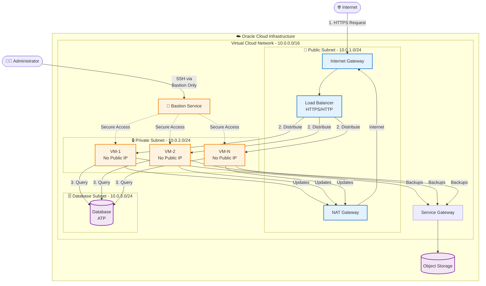

# OCI Flexible and Always Free High Availability Infrastructure


[](https://www.oracle.com/cloud/)


**A fully automated, production-ready infrastructure stack on Oracle Cloud Infrastructure (OCI) leveraging the Always Free Tier.**

This project delivers a **High Availability (HA)** architecture with **zero estimated monthly cost**, featuring redundancy, strict network isolation, and auto-scaling capabilities.

---

## Table of Contents

- [Overview](#-overview)
  - [The Challenge](#the-challenge)
  - [The Solution](#the-solution)
  - [Key Features](#key-features)
- [Architecture](#-architecture)
  - [Diagram](#architecture-diagram)
  - [Components](#architecture-components)
- [Security & Compliance](#-security--compliance)
  - [Posture](#posture)
  - [Quality](#quality)
- [Prerequisites](#-prerequisites)
- [Usage](#-usage)
  - [Integration as a Terraform Module](#integration-as-a-terraform-module)
  - [Standalone Deployment](#setup-instructions-standalone)
- [Configuration](#-configuration)
- [Operations](#-operations)
  - [Accessing VMs](#accessing-vms-via-bastion)
  - [Post-Deployment](#post-deployment-configuration)
  - [Cost Optimization](#cost-optimization)
  - [Backup Strategy](#backup-strategy)
- [Troubleshooting](#-troubleshooting)
- [Contributing & License](#-contributing--license)

---

## Overview

### The Challenge
Startups, students, and developers often need a reliable, production-grade infrastructure to host applications but face significant barriers:
- **High Cloud Costs**: Enterprise-grade features like Load Balancers and HA databases usually come with a steep price tag.
- **Complexity**: Setting up a secure Virtual Cloud Network (VCN) with public/private subnets, NAT gateways, and Bastion hosts is complex and error-prone.
- **Security Risks**: Default configurations often expose databases and backend services to the public internet.

### The Solution
This project provides a **fully automated, production-ready infrastructure stack** on Oracle Cloud Infrastructure (OCI).

It features:
- **Redundancy**: Multiple compute instances behind a Load Balancer.
- **Security**: Strict network isolation with private subnets and Bastion access.
- **Scalability**: Auto-scaling Autonomous Database.
- **Automation**: One-click deployment using Terraform.

### Key Features
- **💰 100% Free**: Designed to fit entirely within OCI's Always Free limits (4 ARM OCPUs, 24GB RAM, 200GB Storage).
- **🛡️ Secure by Design**: Backend services and databases are isolated in private subnets. No public IPs on compute instances.
- **🚀 High Performance**: Uses ARM-based Ampere A1 instances which offer superior performance over traditional x86 micro instances.
- **🔄 High Availability**: Architecture designed to survive instance failures.

---

## Architecture

### Architecture Diagram



### Architecture Components

#### Network
- **VCN**: Virtual Cloud Network with public, backend, and database subnets.
- **Internet Gateway**: Provides public access for the load balancer.
- **NAT Gateway**: Allows private subnet resources to access the internet for updates.
- **Service Gateway**: Enables secure access to OCI services (like Object Storage) without traversing the public internet.

#### Compute
- **Instances**: 1 to 4 VM instances (ARM-based A1.Flex), configurable via `vm_count`.
- **High Availability**: Distributed across availability domains (where available) or fault domains to ensure redundancy.
- **Load Balancer**: Nginx configured as a load balancer with Let's Encrypt SSL for secure traffic distribution.
- **Automation**: Cloud-init scripts for automated instance provisioning and configuration.

#### Database
- **Autonomous Transaction Processing (ATP)**: Fully managed, auto-scaling database.
- **Subnet**: Deployed in a dedicated private subnet for enhanced security.
- **Always Free Tier**: 1 OCPU and 20GB storage included.
- **Features**: Automatic backups, patching, and self-repairing capabilities.

#### Storage
- **Object Storage**: Bucket for storing static assets and backups (20GB free).
- **Block Volumes**: Persistent storage for compute instances (200GB total free).

#### Security
- **Bastion Service**: Secure, ephemeral SSH access to private instances without public IPs.
- **Security Lists & NSGs**: Granular network access control.
- **Private Subnets**: Backend and database resources are isolated from the public internet.

---

## 🛡️ Security & Compliance

This module provisions a production-ready OCI infrastructure optimized for Always Free usage by default, but fully flexible for paid instance types and horizontal scaling.

- **Always Free compliant defaults**
- **Scalable to paid shapes**
- **Security best practices enforced** with Checkov static analysis
- **Bastion-based secure access**
- **CI security scanning**

### Posture

- ✅ No public IPs on compute instances
- ✅ Access via OCI Bastion Service only
- ✅ Private RSA key authentication
- ✅ Oracle-managed encryption at rest
- ✅ In-transit encryption enabled
- ✅ Stateful security lists
- ✅ Regular automated security scans

### Quality

| Check             | Tool                 | Status      |
|-------------------|----------------------|-------------|
| Code Format       | `terraform fmt`      | ✅ Automated |
| Syntax Validation | `terraform validate` | ✅ Automated |
| Best Practices    | TFLint               | ✅ Automated |
| Security Scanning | Checkov              | ✅ Automated |
| Pre-commit Hooks  | pre-commit           | ✅ Enabled   |

---

## 📋 Prerequisites

1. **OCI Account**: Sign up at [https://cloud.oracle.com/](https://cloud.oracle.com/).
2. **API Keys**: Generate API signing keys in the OCI Console.
3. **Terraform**: Install Terraform version >= 1.5.0.
4. **OCI CLI** (Optional): Useful for managing Bastion sessions and advanced operations.

---

## ⚡ Quick Start

To run all checks locally:

```bash
# Install pre-commit hooks
pre-commit install

# Run all checks locally
pre-commit run --all-files
```

---

## 💻 Usage

### Integration as a Terraform Module

You can integrate this stack as a module into your existing Terraform infrastructure.

```hcl
module "oci_ha_stack" {
  source = "git::https://github.com/your-username/terraform-oci-alwaysfree-production-ha-stack.git?ref=main"

  # OCI Authentication
  tenancy_ocid     = var.tenancy_ocid
  user_ocid        = var.user_ocid
  fingerprint      = var.fingerprint
  private_key_path = var.private_key_path
  region           = var.region

  # Project Settings
  project_name = "my-app"
  environment  = "prod"

  # Configuration
  vm_count     = 2
  vm_shape     = "VM.Standard.A1.Flex"
  ssh_public_key_path = "~/.ssh/id_rsa.pub"
  
  # ... other variables
}
```

### Setup Instructions (Standalone)

#### 1. Get My Public IP Address
```bash
curl ifconfig.me
```
Use this IP to restrict access in your security rules.

#### 2. Generate OCI API Keys
```bash
mkdir -p ~/.oci
openssl genrsa -out oci_api_key.pem 2048
chmod 600 oci_api_key.pem
openssl rsa -pubout -in oci_api_key.pem -out oci_api_key_public.pem
```
Upload `oci_api_key_public.pem` to OCI Console.

#### 3. Configure Terraform Variables
```bash
cp terraform.tfvars.example terraform.tfvars
# Edit terraform.tfvars
```

#### 4. Deploy
```bash
terraform init
terraform plan -var-file="env/local.tfvars"
terraform apply -var-file="env/local.tfvars" -auto-approve

terraform refresh -var-file="env/local.tfvars"
```

---

## ⚙️ Configuration

## Requirements

| Name | Version |
|------|---------|
| <a name="requirement_terraform"></a> [terraform](#requirement\_terraform) | >= 1.2.0 |
| <a name="requirement_cloudinit"></a> [cloudinit](#requirement\_cloudinit) | >= 2.3.7 |
| <a name="requirement_null"></a> [null](#requirement\_null) | ~> 3.2.4 |
| <a name="requirement_oci"></a> [oci](#requirement\_oci) | >= 6.33.0 |
| <a name="requirement_random"></a> [random](#requirement\_random) | ~> 3.7.1 |
| <a name="requirement_time"></a> [time](#requirement\_time) | ~> 0.13.1 |
| <a name="requirement_tls"></a> [tls](#requirement\_tls) | ~> 4.0.6 |

## Providers

| Name | Version |
|------|---------|
| <a name="provider_null"></a> [null](#provider\_null) | 3.2.4 |
| <a name="provider_time"></a> [time](#provider\_time) | 0.13.1 |
| <a name="provider_tls"></a> [tls](#provider\_tls) | 4.0.6 |

## Modules

| Name | Source | Version |
|------|--------|---------|
| <a name="module_backend_dns_rrset"></a> [backend\_dns\_rrset](#module\_backend\_dns\_rrset) | ./modules/dns-zone-rrset | n/a |
| <a name="module_backend_dns_zone"></a> [backend\_dns\_zone](#module\_backend\_dns\_zone) | ./modules/dns-zone | n/a |
| <a name="module_backend_load_balancer"></a> [backend\_load\_balancer](#module\_backend\_load\_balancer) | ./modules/load_balancer | n/a |
| <a name="module_bastion"></a> [bastion](#module\_bastion) | ./modules/bastion | n/a |
| <a name="module_bastion_sessions"></a> [bastion\_sessions](#module\_bastion\_sessions) | ./modules/bastion-session | n/a |
| <a name="module_compartment"></a> [compartment](#module\_compartment) | ./modules/compartment | n/a |
| <a name="module_compute"></a> [compute](#module\_compute) | ./modules/compute-ubuntu | n/a |
| <a name="module_database"></a> [database](#module\_database) | ./modules/database | n/a |
| <a name="module_frontend_dns_rrset"></a> [frontend\_dns\_rrset](#module\_frontend\_dns\_rrset) | ./modules/dns-zone-rrset | n/a |
| <a name="module_frontend_dns_zone"></a> [frontend\_dns\_zone](#module\_frontend\_dns\_zone) | ./modules/dns-zone | n/a |
| <a name="module_frontend_load_balancer"></a> [frontend\_load\_balancer](#module\_frontend\_load\_balancer) | ./modules/load_balancer | n/a |
| <a name="module_network"></a> [network](#module\_network) | ./modules/network | n/a |
| <a name="module_ocir"></a> [ocir](#module\_ocir) | ./modules/oci-container-registry | n/a |
| <a name="module_storage"></a> [storage](#module\_storage) | ./modules/storage | n/a |

## Resources

| Name | Type |
|------|------|
| [null_resource.free_tier_guard](https://registry.terraform.io/providers/hashicorp/null/latest/docs/resources/resource) | resource |
| [time_sleep.wait_for_instance](https://registry.terraform.io/providers/hashicorp/time/latest/docs/resources/sleep) | resource |
| [time_sleep.wait_for_instance_configuration](https://registry.terraform.io/providers/hashicorp/time/latest/docs/resources/sleep) | resource |
| [tls_private_key.backend_lb_private_key](https://registry.terraform.io/providers/hashicorp/tls/latest/docs/resources/private_key) | resource |
| [tls_private_key.public_private_key_pair](https://registry.terraform.io/providers/hashicorp/tls/latest/docs/resources/private_key) | resource |
| [tls_self_signed_cert.backend_lb_cert](https://registry.terraform.io/providers/hashicorp/tls/latest/docs/resources/self_signed_cert) | resource |

## Inputs

| Name | Description | Type | Default | Required |
|------|-------------|------|---------|:--------:|
| <a name="input_allowed_ssh_cidrs"></a> [allowed\_ssh\_cidrs](#input\_allowed\_ssh\_cidrs) | List of CIDR blocks allowed to SSH via Bastion | `list(string)` | <pre>[<br/>  "0.0.0.0/0"<br/>]</pre> | no |
| <a name="input_are_legacy_imds_endpoints_disabled"></a> [are\_legacy\_imds\_endpoints\_disabled](#input\_are\_legacy\_imds\_endpoints\_disabled) | Disable legacy IMDS endpoints, IMDSv1 (legacy metadata service) is vulnerable to Server-Side Request Forgery (SSRF) attacks, Any compromised process on the instance can access sensitive metadata without authentication, This is a known attack vector used in real-world cloud breaches, Disabling legacy endpoints forces use of IMDSv2 which requires session tokens | `bool` | `true` | no |
| <a name="input_atp_admin_password"></a> [atp\_admin\_password](#input\_atp\_admin\_password) | ATP admin password (min 12 chars, must include upper, lower, number) | `string` | `null` | no |
| <a name="input_atp_db_name"></a> [atp\_db\_name](#input\_atp\_db\_name) | Autonomous Database name | `string` | `"habackenddb"` | no |
| <a name="input_backend_domain_name"></a> [backend\_domain\_name](#input\_backend\_domain\_name) | Domain name for the backend load balancer | `string` | n/a | yes |
| <a name="input_cloud_init_config"></a> [cloud\_init\_config](#input\_cloud\_init\_config) | Cloud-init configuration for instances | `string` | `""` | no |
| <a name="input_database_subnet_cidr"></a> [database\_subnet\_cidr](#input\_database\_subnet\_cidr) | Database subnet CIDR block | `string` | `"10.0.3.0/24"` | no |
| <a name="input_enable_backend_lb"></a> [enable\_backend\_lb](#input\_enable\_backend\_lb) | Enable or disable the Backend Load Balancer | `bool` | `true` | no |
| <a name="input_enable_backups"></a> [enable\_backups](#input\_enable\_backups) | Enable automated backups for block volumes | `bool` | `true` | no |
| <a name="input_enable_bastion"></a> [enable\_bastion](#input\_enable\_bastion) | Enable or disable Bastion service | `bool` | `true` | no |
| <a name="input_enable_database"></a> [enable\_database](#input\_enable\_database) | Enable or disable the Autonomous Database | `bool` | `true` | no |
| <a name="input_enable_dns"></a> [enable\_dns](#input\_enable\_dns) | Enable or disable DNS resources | `bool` | `true` | no |
| <a name="input_enable_egress_security_rules_stateless"></a> [enable\_egress\_security\_rules\_stateless](#input\_enable\_egress\_security\_rules\_stateless) | Whether to enable stateless egress security rules | `bool` | `false` | no |
| <a name="input_enable_frontend_lb"></a> [enable\_frontend\_lb](#input\_enable\_frontend\_lb) | Enable or disable the Frontend Load Balancer | `bool` | `true` | no |
| <a name="input_enable_ocir"></a> [enable\_ocir](#input\_enable\_ocir) | Enable or disable OCI Container Registry | `bool` | `true` | no |
| <a name="input_enable_storage"></a> [enable\_storage](#input\_enable\_storage) | Enable or disable Storage resources | `bool` | `true` | no |
| <a name="input_environment"></a> [environment](#input\_environment) | Environment name (dev, staging, prod) | `string` | `"dev"` | no |
| <a name="input_free_tier_mode"></a> [free\_tier\_mode](#input\_free\_tier\_mode) | Enable strict Always Free limits validation | `bool` | `true` | no |
| <a name="input_frontend_domain_name"></a> [frontend\_domain\_name](#input\_frontend\_domain\_name) | Domain name for the frontend load balancer | `string` | n/a | yes |
| <a name="input_github_actions_email"></a> [github\_actions\_email](#input\_github\_actions\_email) | Email for GitHub Actions user (optional, leave empty to skip GitHub Actions setup) | `string` | `""` | no |
| <a name="input_github_actions_public_key"></a> [github\_actions\_public\_key](#input\_github\_actions\_public\_key) | Public Key for GitHub Actions user (optional, leave empty to skip GitHub Actions setup) | `string` | `""` | no |
| <a name="input_instance_image_ocid"></a> [instance\_image\_ocid](#input\_instance\_image\_ocid) | n/a | `map(string)` | <pre>{<br/>  "eu-amsterdam-1": "ocid1.image.oc1.eu-amsterdam-1.aaaaaaaai5hr6qpvn4crggx6qffx2ckkpgvozcebdi44ykspx5dxpabjm3vq",<br/>  "eu-frankfurt-1": "ocid1.image.oc1.eu-frankfurt-1.aaaaaaaadvi77prh3vjijhwe5xbd6kjg3n5ndxjcpod6om6qaiqeu3csof7a",<br/>  "eu-marseille-1": "ocid1.image.oc1.eu-marseille-1.aaaaaaaawmjm3gek2tgwdbttgn6qyb5rzrrgrdaibeu6lyfgjgolh4kceumq",<br/>  "eu-marseille-1-aarch64": "ocid1.image.oc1.eu-marseille-1.aaaaaaaa457toyb4brqmdbcjdvjchspijbpjb3rubfddf7cgqrpfmjp55txq",<br/>  "uk-london-1": "ocid1.image.oc1.uk-london-1.aaaaaaaaw5gvriwzjhzt2tnylrfnpanz5ndztyrv3zpwhlzxdbkqsjfkwxaq",<br/>  "us-ashburn-1": "ocid1.image.oc1.iad.aaaaaaaa6tp7lhyrcokdtf7vrbmxyp2pctgg4uxvt4jz4vc47qoc2ec4anha",<br/>  "us-phoenix-1": "ocid1.image.oc1.phx.aaaaaaaa6hooptnlbfwr5lwemqjbu3uqidntrlhnt45yihfj222zahe7p3wq"<br/>}</pre> | no |
| <a name="input_is_pv_encryption_in_transit_enabled"></a> [is\_pv\_encryption\_in\_transit\_enabled](#input\_is\_pv\_encryption\_in\_transit\_enabled) | Enable in-transit encryption for boot volumes. Protects data in transit between compute instance and boot volume. Prevents man-in-the-middle attacks on internal OCI network. Zero performance impact (hardware-accelerated). Required for many compliance frameworks (PCI-DSS, HIPAA, etc.). | `bool` | `true` | no |
| <a name="input_object_events_enabled"></a> [object\_events\_enabled](#input\_object\_events\_enabled) | Enables audit logging and compliance tracking, Allows automation based on object operations, required for security monitoring and alerting | `bool` | `true` | no |
| <a name="input_private_security_list_ingress_security_rules"></a> [private\_security\_list\_ingress\_security\_rules](#input\_private\_security\_list\_ingress\_security\_rules) | Private Security List of ingress security rules | <pre>list(object({<br/>    protocol = string<br/>    port_min = number<br/>    port_max = number<br/>  }))</pre> | <pre>[<br/>  {<br/>    "port_max": 22,<br/>    "port_min": 22,<br/>    "protocol": "6"<br/>  },<br/>  {<br/>    "port_max": 80,<br/>    "port_min": 80,<br/>    "protocol": "6"<br/>  },<br/>  {<br/>    "port_max": 443,<br/>    "port_min": 443,<br/>    "protocol": "6"<br/>  },<br/>  {<br/>    "port_max": 1522,<br/>    "port_min": 1521,<br/>    "protocol": "6"<br/>  },<br/>  {<br/>    "port_max": 8443,<br/>    "port_min": 8443,<br/>    "protocol": "6"<br/>  }<br/>]</pre> | no |
| <a name="input_private_subnet_cidr"></a> [private\_subnet\_cidr](#input\_private\_subnet\_cidr) | Private subnet CIDR block | `string` | `"10.0.2.0/24"` | no |
| <a name="input_project_name"></a> [project\_name](#input\_project\_name) | Project name for resource naming | `string` | `"ha-backend"` | no |
| <a name="input_public_security_list_ingress_security_rules"></a> [public\_security\_list\_ingress\_security\_rules](#input\_public\_security\_list\_ingress\_security\_rules) | Public Security List of ingress security rules | <pre>list(object({<br/>    protocol = string<br/>    port_min = number<br/>    port_max = number<br/>    source   = string<br/>  }))</pre> | <pre>[<br/>  {<br/>    "port_max": 22,<br/>    "port_min": 22,<br/>    "protocol": "6",<br/>    "source": "0.0.0.0/0"<br/>  },<br/>  {<br/>    "port_max": 80,<br/>    "port_min": 80,<br/>    "protocol": "6",<br/>    "source": "0.0.0.0/0"<br/>  },<br/>  {<br/>    "port_max": 443,<br/>    "port_min": 443,<br/>    "protocol": "6",<br/>    "source": "0.0.0.0/0"<br/>  }<br/>]</pre> | no |
| <a name="input_public_subnet_cidr"></a> [public\_subnet\_cidr](#input\_public\_subnet\_cidr) | Public subnet CIDR block | `string` | `"10.0.1.0/24"` | no |
| <a name="input_region"></a> [region](#input\_region) | OCI Region | `string` | `"eu-marseille-1"` | no |
| <a name="input_ssh_public_key_path"></a> [ssh\_public\_key\_path](#input\_ssh\_public\_key\_path) | Path to SSH public key for VM access | `string` | n/a | yes |
| <a name="input_tags"></a> [tags](#input\_tags) | Common tags for all resources | `map(string)` | <pre>{<br/>  "CostCenter": "AlwaysFree",<br/>  "ManagedBy": "Terraform"<br/>}</pre> | no |
| <a name="input_tenancy_ocid"></a> [tenancy\_ocid](#input\_tenancy\_ocid) | OCI Tenancy OCID | `string` | n/a | yes |
| <a name="input_vcn_cidr"></a> [vcn\_cidr](#input\_vcn\_cidr) | VCN CIDR block | `string` | `"10.0.0.0/16"` | no |
| <a name="input_vm_boot_volume_size_gb"></a> [vm\_boot\_volume\_size\_gb](#input\_vm\_boot\_volume\_size\_gb) | Boot volume size in GB | `number` | `50` | no |
| <a name="input_vm_count"></a> [vm\_count](#input\_vm\_count) | Number of VM instances | `number` | `2` | no |
| <a name="input_vm_memory_gb"></a> [vm\_memory\_gb](#input\_vm\_memory\_gb) | Memory in GB per VM (max 24GB for A1 free tier total) | `number` | `12` | no |
| <a name="input_vm_ocpus"></a> [vm\_ocpus](#input\_vm\_ocpus) | Number of OCPUs per VM (max 4 for A1 free tier total) | `number` | `2` | no |
| <a name="input_vm_shape"></a> [vm\_shape](#input\_vm\_shape) | VM shape (VM.Standard.E2.1.Micro or VM.Standard.A1.Flex) | `string` | `"VM.Standard.A1.Flex"` | no |

## Outputs

| Name | Description |
|------|-------------|
| <a name="output_atp_wallet_content"></a> [atp\_wallet\_content](#output\_atp\_wallet\_content) | Base64 encoded content of the ATP wallet (Sensitive) |
| <a name="output_autonomous_database_id"></a> [autonomous\_database\_id](#output\_autonomous\_database\_id) | OCID of the Autonomous Database |
| <a name="output_backend_load_balancer_public_ip"></a> [backend\_load\_balancer\_public\_ip](#output\_backend\_load\_balancer\_public\_ip) | Public IP of the Backend Load Balancer |
| <a name="output_bastion_id"></a> [bastion\_id](#output\_bastion\_id) | OCID of the Bastion Service |
| <a name="output_bastion_ssh_metadata"></a> [bastion\_ssh\_metadata](#output\_bastion\_ssh\_metadata) | Metadata for Bastion sessions (if any) |
| <a name="output_block_volume_ids"></a> [block\_volume\_ids](#output\_block\_volume\_ids) | OCIDs of the Block Volumes |
| <a name="output_database_connection_strings"></a> [database\_connection\_strings](#output\_database\_connection\_strings) | Connection strings for the Autonomous Database |
| <a name="output_database_subnet_id"></a> [database\_subnet\_id](#output\_database\_subnet\_id) | OCID of the Database Subnet |
| <a name="output_frontend_load_balancer_public_ip"></a> [frontend\_load\_balancer\_public\_ip](#output\_frontend\_load\_balancer\_public\_ip) | Public IP of the Frontent Load Balancer |
| <a name="output_instance_ids"></a> [instance\_ids](#output\_instance\_ids) | OCIDs of the Compute Instances |
| <a name="output_instance_names"></a> [instance\_names](#output\_instance\_names) | Display names of the Compute Instances |
| <a name="output_instance_private_ips"></a> [instance\_private\_ips](#output\_instance\_private\_ips) | Private IP addresses of the Compute Instances |
| <a name="output_object_storage_bucket_name"></a> [object\_storage\_bucket\_name](#output\_object\_storage\_bucket\_name) | Name of the Object Storage Bucket |
| <a name="output_object_storage_namespace"></a> [object\_storage\_namespace](#output\_object\_storage\_namespace) | Object Storage Namespace |
| <a name="output_ocir_auth_token"></a> [ocir\_auth\_token](#output\_ocir\_auth\_token) | Auth token for OCIR login (Sensitive) |
| <a name="output_ocir_repository_url"></a> [ocir\_repository\_url](#output\_ocir\_repository\_url) | URL of the OCIR Repository |
| <a name="output_ocir_username"></a> [ocir\_username](#output\_ocir\_username) | Username for OCIR login (e.g. for GitHub Actions) |
| <a name="output_private_subnet_id"></a> [private\_subnet\_id](#output\_private\_subnet\_id) | OCID of the Private (Backend) Subnet |
| <a name="output_public_subnet_id"></a> [public\_subnet\_id](#output\_public\_subnet\_id) | OCID of the Public Subnet |
| <a name="output_vcn_cidr"></a> [vcn\_cidr](#output\_vcn\_cidr) | CIDR block of the VCN |
| <a name="output_vcn_id"></a> [vcn\_id](#output\_vcn\_id) | OCID of the Virtual Cloud Network (VCN) |

---

## Operations

### Accessing VMs via Bastion

Since the compute instances are in a private subnet, you must use the OCI Bastion service to connect.

**1. Get Bastion Session Connection**
```bash
terraform output bastion_connection_metadata
```

**2. Connect via SSH**

```shell
ssh -i <your-private-key-path> -o ProxyCommand="ssh -i <your-private-key-path> -W <instance_private_ip>:22 <session_id>@host.bastion.<region>.oci.oraclecloud.com" -p 22 ubuntu@<instance_private_ip>
```

### Post-Deployment Configuration

- **Nginx**: Configured to route traffic. Update upstream servers in `/etc/nginx/conf.d/backend.conf`.
- **Database**: Download the wallet using `terraform output -raw atp_wallet_content | base64 -d > wallet.zip`.

### Cost Optimization
This stack is designed to fit within the **OCI Always Free Tier**:
- **Compute**: 4 OCPUs, 24GB RAM (ARM).
- **Database**: 20GB Autonomous Database.
- **Storage**: 200GB Block Volume, 20GB Object Storage.
- **Networking**: 10TB outbound data transfer.

**Estimated Monthly Cost: $0.00**

### Backup Strategy
- **Automated**: ATP Daily automatic backups, Object Storage Versioning.
- **Manual**: Use OCI CLI or Console to create boot volume backups.

---

## Troubleshooting

- **Instance Capacity**: If A1.Flex instances are unavailable, try a different region.
- **Terraform Locks**: Use `terraform force-unlock <lock_id>` if needed.
- **Cloud-Init**: Check logs at `/var/log/cloud-init-output.log`.

---

## Contributing & License

See [CONTRIBUTING.md](CONTRIBUTING.md) for development guidelines.

This project is licensed under the MIT License - see [LICENSE](LICENSE) file.
