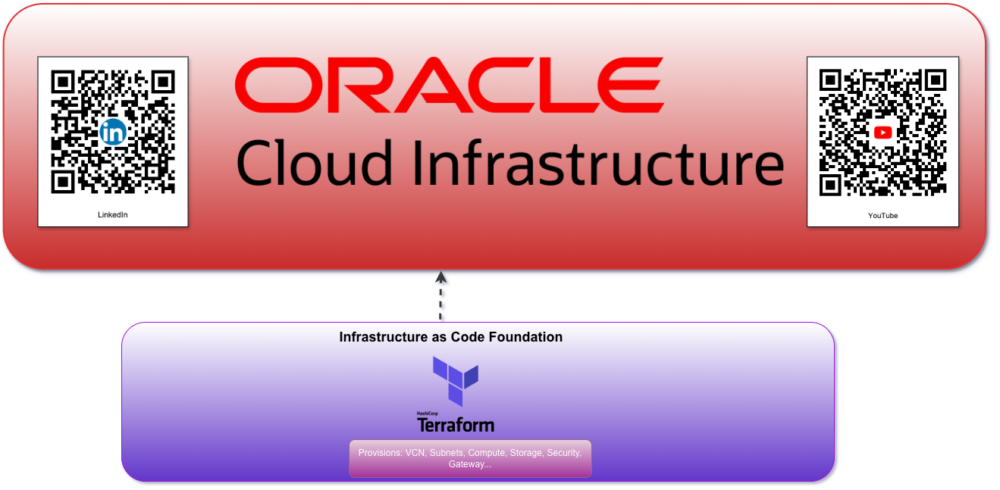
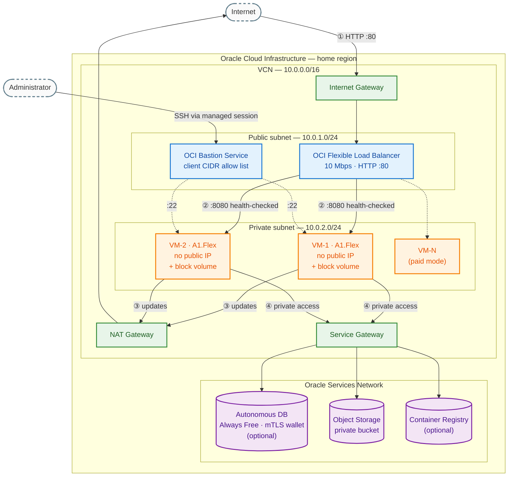

# Terraform OCI Always Free & Flexible HA Compute Stack (IaC)


[](https://registry.terraform.io/modules/devsahamerlin/alwaysfree-and-flexible-ha-compute-service/oci)

[](https://github.com/devsahamerlin/terraform-oci-alwaysfree-and-flexible-ha-compute-service/actions/workflows/ci.yml)
[](LICENSE)
[](https://www.oracle.com/cloud/free/)


**A Terraform module (Infrastructure as Code) for a secure, highly available compute stack on Oracle Cloud Infrastructure (OCI): $0/month by default, scales to paid shapes with one flag.**

Private VMs behind a load balancer, SSH through the OCI Bastion service only, plus optional Autonomous Database, Object Storage, block volumes, DNS and Container Registry. Built-in guardrails stop `terraform plan` before anything outside the Always Free tier gets created. Built and tested with Terraform; OpenTofu-compatible for teams that need it.



## Quick start with Terraform

```hcl
provider "oci" {
  region = "eu-marseille-1" # your tenancy home region
  # Authentication: ~/.oci/config, environment variables, or user_ocid/fingerprint/private_key_path
}

module "ha_stack" {
  source  = "devsahamerlin/alwaysfree-and-flexible-ha-compute-service/oci"
  version = "~> 1.0"

  tenancy_ocid      = var.tenancy_ocid
  region            = "eu-marseille-1"
  ssh_public_key    = file("~/.ssh/id_rsa.pub")
  allowed_ssh_cidrs = ["203.0.113.10/32"] # your public IP: curl ifconfig.me
  cloud_init_config = file("${path.module}/cloud-init.yaml") # your app must listen on :8080 for the LB health check
}

output "app_url" {
  value = "http://${module.ha_stack.frontend_load_balancer_public_ip}"
}
```

With the defaults you get 2 Ampere A1 VMs (1 OCPU / 6 GB each) in a private subnet, a public 10 Mbps load balancer, a Bastion service with one SSH session per VM, a private bucket and one 50 GB block volume attached to each VM: **30 resources, all inside the Always Free tier**.

---

## Table of contents

- [Why this Terraform IaC module exists](#why-this-terraform-iac-module-exists)
- [Terraform IaC design goals](#terraform-iac-design-goals)
- [How the Terraform module works](#how-the-terraform-module-works)
  - [Architecture](#architecture)
  - [Components](#components)
  - [Always Free guardrails](#always-free-guardrails)
  - [Usage](#usage)
  - [Prerequisites](#prerequisites)
  - [Operations](#operations)
  - [Terraform IaC quality pipeline & testing](#terraform-iac-quality-pipeline--testing)
  - [Terraform IaC design decisions & trade-offs](#terraform-iac-design-decisions--trade-offs)
- [Results: what the Terraform module delivers](#results-what-the-terraform-module-delivers)
  - [Cost](#cost)
  - [Known limitations & roadmap](#known-limitations--roadmap)
- [Terraform reference (inputs, outputs, resources)](#terraform-reference-inputs-outputs-resources)
- [Contributing, security & license](#contributing-security--license)

---

## Why this Terraform IaC module exists

Side projects, student labs and startup MVPs need infrastructure that behaves like production (redundancy, private networking, controlled access), but rarely have the budget for it:

- **Cost**: load balancers, managed databases and redundant instances usually come with a monthly bill.
- **Complexity**: a secure Virtual Cloud Network (public and private subnets, NAT and service gateways, route tables, security lists, bastion) is easy to get wrong.
- **Security**: the quick path (one VM with a public IP and port 22 open to the world) is the one attackers scan for.
- **Surprise bills**: one extra OCPU, a second load balancer or a backup policy can silently move an "Always Free" project into paid usage.

OCI's Always Free tier covers a real HA setup, if you stay inside its limits. The limits below come from the [official Always Free documentation](https://docs.oracle.com/en-us/iaas/Content/FreeTier/freetier_topic-Always_Free_Resources.htm) (checked November 2026):

| Resource | Always Free allowance | Default usage in this module |
|---|---|---|
| Ampere A1 compute | 1,500 OCPU hours + 9,000 GB hours per month, i.e. **2 OCPUs and 12 GB** | 2 VMs × (1 OCPU, 6 GB) |
| Block Volume | **200 GB** total (boot + block volumes), **5** volume backups | 2 × 50 GB boot + 2 × 50 GB block, no scheduled backups |
| Flexible Load Balancer | **1** instance, 10 Mbps | 1 public load balancer, 10 Mbps |
| Object Storage | 20 GB (Always Free-only accounts) | 1 private, versioned bucket |
| Autonomous Database | 2 instances, 1 OCPU and 20 GB each | 1 ATP, optional (`enable_database`) |
| Bastion | Free | 1 bastion, 1 managed SSH session per VM |

> [!IMPORTANT]
> Always Free resources must be created in your tenancy **home region**. Set `region` accordingly.

## Terraform IaC design goals

| # | Goal | Translated into |
|---|---|---|
| G1 | **$0 by default** | `free_tier_mode = true` by default, with plan-time guardrails for every Always Free limit the module can exceed |
| G2 | **Private by default** | No public IP on VMs, SSH only through OCI Bastion, least-privilege security lists |
| G3 | **High availability** | ≥ 2 VMs behind a health-checked load balancer, spread across availability domains when the region has several |
| G4 | **Scale with one flag** | `free_tier_mode = false` keeps the same architecture and unlocks any shape and size |
| G5 | **One module, opt-in features** | Database, storage, DNS, OCIR and bastion behind `enable_*` flags |
| G6 | **Verifiable** | fmt, validate, TFLint, Checkov and Terratest run in CI |

**Non-goals**: multi-region deployment, Kubernetes (OKE), managing your application code. The module provisions infrastructure; your app comes through `cloud_init_config` or your own CI/CD.

## How the Terraform module works

### Architecture



An optional **private backend load balancer** (HTTPS :443 with a self-signed certificate, backends on :8000) can replace the public one, or run alongside it in paid mode.

### Components

| Component | Resources | Always Free | Notes |
|---|---|---|---|
| Compartment | `oci_identity_compartment` | Yes | Named `<project_name>-<environment>`, kept on destroy unless `compartment_enable_delete = true` |
| Network | VCN, internet / NAT / service gateways, 2 subnets, route tables, security lists | Yes | Database subnet only in paid mode (Always Free ATP has no private endpoint) |
| Compute | `oci_core_instance` × `vm_count` | Yes (A1, ≤ 2 OCPUs / 12 GB) | Ubuntu, no public IP, IMDSv1 disabled, in-transit encryption, Bastion and OS Management agent plugins |
| Load balancer | Flexible LB, backend set, backends, listener, path routes | Yes (1 LB, 10 Mbps) | Frontend: public, HTTP :80 → VMs :8080. Backend: private, HTTPS :443 → VMs :8000 |
| Bastion | `oci_bastion_bastion`, one managed SSH session per VM | Yes | Sessions last 3 hours |
| Storage | Private bucket (versioned), one block volume attached per VM | Yes (≤ 200 GB, no backups) | Optional daily backups (paid) |
| Database | Autonomous Transaction Processing + wallet | Yes (Always Free ATP) | Optional, public endpoint secured by mTLS in free mode |
| DNS | Zones and A records | Not listed in Always Free | Optional, requires a domain delegated to OCI DNS |
| OCIR | Repository, dynamic group and pull policy, optional GitHub Actions user | Not listed in Always Free | Optional, creates tenancy-level IAM resources |

### Always Free guardrails

With `free_tier_mode = true` (the default), `terraform plan` fails before anything is created when a rule is broken. Each rule has its own error message:

| Rule | Limit | Fix suggested by the error |
|---|---|---|
| Shape | `VM.Standard.A1.Flex` only | Use A1 or set `free_tier_mode = false` |
| OCPUs | `vm_count × vm_ocpus ≤ 2` | Reduce `vm_count` / `vm_ocpus` |
| Memory | `vm_count × vm_memory_gb ≤ 12` | Reduce `vm_count` / `vm_memory_gb` |
| Load balancers | At most 1 of `enable_frontend_lb` / `enable_backend_lb` | Keep a single load balancer |
| Block storage | `vm_count × (boot + block volume) ≤ 200 GB` | Reduce sizes or `vm_count` |
| Backups | No `enable_backups` together with `enable_storage` | Daily backups exceed the 5 free backups |

Example, with 2 VMs of 2 OCPUs / 12 GB and backups enabled:

```text
Error: Resource precondition failed
  Always Free validation failed: 4 OCPUs requested (vm_count x vm_ocpus), the Always Free limit is 2 OCPUs.
  Set free_tier_mode = false to scale beyond it.
Error: Resource precondition failed
  Always Free validation failed: 24 GB of memory requested (vm_count x vm_memory_gb), the Always Free limit is 12 GB. ...
Error: Resource precondition failed
  Always Free validation failed: daily block volume backups with 7-day retention exceed the 5 Always Free volume backups. ...
```

Two input checks are enforced in every mode: `atp_admin_password` is required with `enable_database`, and domain names are required with `enable_dns`. A non-blocking warning is printed when `allowed_ssh_cidrs` contains `0.0.0.0/0`.

### Usage

#### As a module from the Terraform Registry

See [Quick start with Terraform](#quick-start-with-terraform). The calling configuration owns the `oci` provider; the module only declares version constraints. Pass the key **content** to `ssh_public_key`, not a path.

#### Standalone, with the bundled example

```bash
git clone https://github.com/devsahamerlin/terraform-oci-alwaysfree-and-flexible-ha-compute-service.git
cd terraform-oci-alwaysfree-and-flexible-ha-compute-service/examples/example-1

cp terraform.tfvars.example terraform.tfvars   # fill in your OCIDs, key paths and home region
terraform init
terraform plan -out tfplan.out
terraform apply tfplan.out
```

The example includes a `cloud-init.yaml` that installs Nginx and serves a page showing which instance answered, so you can see the load balancing at work. See [examples/example-1/README.md](examples/example-1/README.md).

#### Free vs paid

```hcl
# Always Free (default)
free_tier_mode = true
vm_count       = 2
vm_shape       = "VM.Standard.A1.Flex"
vm_ocpus       = 1
vm_memory_gb   = 6
```

```hcl
# Paid: same architecture, any shape and size
free_tier_mode    = false
vm_count          = 3
vm_shape          = "VM.Standard.E4.Flex"
vm_ocpus          = 2
vm_memory_gb      = 16
enable_backend_lb = true # a second load balancer is allowed in paid mode
enable_backups    = true
```

With `free_tier_mode = false` and `enable_database = true`, the ATP is created as a paid instance with a private endpoint in the dedicated database subnet.

### Prerequisites

1. An **OCI account**: [cloud.oracle.com](https://cloud.oracle.com/). Note your home region.
2. **Terraform ≥ 1.5** (recommended). OpenTofu also works: the module is validated with Terraform 1.10 and OpenTofu 1.11.
3. An **API signing key** for your user:
   ```bash
   mkdir -p ~/.oci
   openssl genrsa -out ~/.oci/oci_api_key.pem 2048
   chmod 600 ~/.oci/oci_api_key.pem
   openssl rsa -pubout -in ~/.oci/oci_api_key.pem -out ~/.oci/oci_api_key_public.pem
   ```
   Upload `oci_api_key_public.pem` in the OCI Console (**Profile → API keys**) and note the fingerprint.
4. An **SSH key pair** for the VMs (e.g. `ssh-keygen -t ed25519`).
5. Your **public IP** for the Bastion allow list: `curl ifconfig.me`, then use `x.x.x.x/32`.
6. Optional: the **OCI CLI**, for Bastion sessions and troubleshooting.

### Operations

#### SSH into a private VM through Bastion

```bash
terraform output bastion_connection_metadata
```

Each VM has a ready-to-use command:

```bash
ssh -i ~/.ssh/id_rsa \
  -o ProxyCommand="ssh -i ~/.ssh/id_rsa -W <private_ip>:22 -p 22 <session_ocid>@host.bastion.<region>.oci.oraclecloud.com" \
  -p 22 ubuntu@<private_ip>
```

Sessions expire after 3 hours. Run `terraform apply` again to create new ones.

#### Check the load balancing

```bash
LB=$(terraform output -raw frontend_load_balancer_public_ip)
for i in 1 2 3 4; do curl -s "http://$LB/" | grep -o 'vm-[0-9]*'; done
```

The load balancer uses round robin with cookie-based session persistence (`APP_SESSION`): requests without the cookie alternate between VMs.

#### Use the attached block volume

Each VM gets a paravirtualized block volume (usually `/dev/sdb`, check with `lsblk`):

```bash
sudo mkfs.ext4 /dev/sdb && sudo mkdir -p /data && sudo mount /dev/sdb /data
echo '/dev/sdb /data ext4 defaults,_netdev,nofail 0 2' | sudo tee -a /etc/fstab
```

#### Connect to the database

```bash
terraform output -raw atp_wallet_content | base64 -d > wallet.zip   # wallet password = atp_admin_password
terraform output database_connection_strings
```

#### Troubleshooting

| Symptom | Cause / fix |
|---|---|
| `Out of host capacity` on A1 | A1 capacity is shared. Retry later, or try another availability domain if your home region has several |
| `401-NotAuthenticated` | Check `tenancy_ocid`, `user_ocid`, `fingerprint` and that `private_key_path` is readable |
| Bastion session creation fails | The Bastion plugin was not running yet. The module waits 10 minutes; run `terraform apply` again if needed |
| LB backends `CRITICAL` | Your app must listen on :8080 (frontend) or :8000 (backend), and the private security list must allow these ports (default) |
| Cloud-init issues | Logs in `/var/log/cloud-init-output.log` on the VM |
| Terraform lock | `terraform force-unlock <lock_id>` |

### Terraform IaC quality pipeline & testing

| Check | Tool | Where |
|---|---|---|
| Formatting | `terraform fmt -check -recursive` | CI + pre-commit |
| Syntax | `terraform validate` (root and example) | CI + pre-commit |
| Best practices | TFLint (recommended preset) | CI + pre-commit |
| Security | Checkov, results uploaded as SARIF to GitHub code scanning | CI + pre-commit |
| Docs | terraform-docs (Reference tables below) | pre-commit |
| Infrastructure tests | Terratest smoke test on real OCI (Always Free) resources | CI on `main` and on demand |

```mermaid
graph LR
    Dev(["👤 Contributor"])
    GHSec["🔐 GitHub code scanning"]

    subgraph GIT["Git flow"]
        direction TB
        Feature["feature/* branch"]
        PR["Pull request to main"]
        Gate{"All checks passed?"}
        Main["main branch"]
    end

    subgraph CI_PR["CI — pull request"]
        direction TB
        PR_FMT["fmt -check"]
        PR_VAL["validate<br/>root + example"]
        PR_SEC["🛡️ Checkov"]
        PR_LINT["🔍 TFLint"]
        PR_CMT["💬 Checkov results<br/>as PR comment"]
    end

    subgraph CI_MAIN["CI — push to main / manual"]
        direction TB
        M_CHECKS["fmt · validate · Checkov · TFLint"]
        M_TEST["🧪 Terratest smoke test<br/>real OCI resources"]
        M_DONE["✅ main verified"]
    end

    Dev -->|"① push"| Feature -->|"② open PR"| PR -->|"③ triggers"| CI_PR
    PR_FMT --> PR_VAL --> PR_SEC --> PR_LINT --> PR_CMT -->|"④ review"| Gate
    Gate -->|"❌ fix"| Feature
    Gate -->|"✅ merge"| Main -->|"⑤ triggers"| CI_MAIN
    M_CHECKS --> M_TEST --> M_DONE
    PR_SEC -.->|SARIF| GHSec
    M_CHECKS -.->|SARIF| GHSec

    classDef actor    fill:#fafafa,stroke:#607d8b,stroke-width:2px,stroke-dasharray:5 5
    classDef git      fill:#e3f2fd,stroke:#1976d2,stroke-width:2px,color:#0d47a1
    classDef validate fill:#e8f5e9,stroke:#388e3c,stroke-width:2px,color:#1b5e20
    classDef security fill:#fff3e0,stroke:#f57c00,stroke-width:2px,color:#e65100
    classDef test     fill:#fff9c4,stroke:#fbc02d,stroke-width:2px,color:#f57f17
    classDef gate     fill:#f3e5f5,stroke:#7b1fa2,stroke-width:2px,color:#4a148c

    class Dev,GHSec actor
    class Feature,PR,Main git
    class PR_FMT,PR_VAL,M_CHECKS,M_DONE validate
    class PR_SEC,PR_LINT,PR_CMT security
    class M_TEST test
    class Gate gate
```



Terratest deploys real resources, so it never runs on pull requests from forks (they don't get the OCI secrets). Run the checks locally:

```bash
pre-commit install
pre-commit run --all-files

cd test
go test -v -run TestSmokeNetworkAndCompute -timeout 20m   # network + 1 VM, Always Free
go test -v -run TestStagingFullStack -timeout 60m         # full stack, including an HTTP check through the LB
```

See [test/README.md](test/README.md) for the required environment variables.

### Terraform IaC design decisions & trade-offs

Every shortcut is written down, with what it costs and when to revisit it.

#### Security exceptions (from [`.checkov.yaml`](.checkov.yaml))

| Checkov ID | Decision | Why | Trade-off | When to change |
|---|---|---|---|---|
| `CKV_OCI_17` | Stateful security lists | Return traffic is handled automatically, so rules are simpler and harder to get wrong | Connection tracking has a small cost at very high throughput | Set `enable_egress_security_rules_stateless = true` for extreme throughput |
| `CKV_OCI_19` | Skip "0.0.0.0/0 to port 22" | False positive: Checkov cannot evaluate dynamic blocks. The public list only opens 80/443, port 22 is VCN-only and SSH goes through Bastion | A real misconfiguration in a custom rule would not be flagged by this check | Keep `public_security_list_ingress_security_rules` free of port 22 |
| `CKV_OCI_20` | Skip "0.0.0.0/0 to port 3389" | False positive (dynamic blocks), Linux only, no RDP, no public IP | Same as above | Windows workloads |
| `CKV_OCI_9`, `CKV_OCI_3` | Oracle-managed encryption keys for the bucket and the volumes | AES-256 at rest with no key management to operate. HSM keys need a paid vault | You don't control key rotation or revocation | PCI, PHI or PII data: add OCI Vault customer-managed keys |
| `CKV_OCI_2` | Backups through a separate policy assignment | Checkov does not link `oci_core_volume_backup_policy_assignment` to the volume | The check cannot see the backup | Not applicable (detection limit) |
| `CKV_TF_1` | No commit hash on module sources | Submodules are local paths | None for consumers, who pin the Registry version | Not applicable |

#### Architecture trade-offs

| Decision | Why | Trade-off | When to change |
|---|---|---|---|
| Flexible LB at 10 Mbps | The only free load balancer shape | 10 Mbps caps throughput (~1 MB/s) | Paid mode: raise the bandwidth in the LB submodule, or use a CDN for static assets |
| One load balancer in free mode | Always Free includes 1 | Choose either the public frontend LB or the private backend LB | `free_tier_mode = false` |
| Frontend LB on HTTP :80 | No certificate to manage for a first deployment | Traffic between clients and the LB is not encrypted | Put TLS in front (roadmap: frontend HTTPS with your certificate) |
| Always Free ATP on a public endpoint | Always Free ATP does not support private endpoints | The endpoint is reachable from the internet, protected by the mTLS wallet and the admin password | Paid mode (private endpoint), or the ATP access list (roadmap) |
| Self-signed certificate on the backend LB | Internal traffic only, no CA dependency | Clients must skip verification or trust the certificate | Use a certificate from OCI Certificates or your CA |
| Bastion sessions managed by Terraform | `terraform output` gives a working SSH command right after apply | Sessions expire after 3 hours, so the next plan recreates them | Create sessions on demand with the OCI CLI (roadmap: optional sessions) |
| 10-minute wait before creating sessions | The Bastion agent plugin needs time to start on new VMs | Slower first apply (only when `enable_bastion = true`) | Lower it if your images start the plugin faster |
| Backups off by default | Daily backups with 7-day retention exceed the 5 free backups | No automatic block volume backups in free mode | `enable_backups = true` with `free_tier_mode = false` |
| Compartment kept on destroy | Protects against deleting a compartment by mistake | `terraform destroy` leaves an empty compartment | `compartment_enable_delete = true` for ephemeral environments |
| Image map with a lookup fallback | Pinned image OCIDs give reproducible VMs in the listed regions | Pinned images age; the lookup picks the latest image, so results can change over time | Pin your own image in `instance_image_ocid` |
| `null_resource` guardrails | Clear, per-rule errors at plan time, Terraform ≥ 1.5 compatible | Adds two no-op resources to the state | Move to `terraform_data` when the minimum version is raised |

## Results: what the Terraform module delivers

| Goal | Outcome | Evidence |
|---|---|---|
| G1 · $0 by default | The plan fails before creating anything outside the Always Free tier | 6 guardrail scenarios checked with `terraform plan` against a real tenancy: the free defaults (30 resources) and the paid E4.Flex setup (33 resources) pass; 4 OCPUs / 24 GB, two load balancers, and storage with backups are rejected with explicit messages |
| G2 · Private by default | VMs have no public IP; SSH only through Bastion; the public subnet only exposes 80/443 | Checkov: 10 passed, 0 failed (exceptions documented above); TFLint: 0 issues |
| G3 · High availability | 2 VMs behind a health-checked load balancer, one backend per VM | The plan creates one LB backend per VM and an HTTP listener; `TestStagingFullStack` asserts an HTTP 200 from the app through the load balancer |
| G4 · Scale with one flag | Same code path for free and paid | `free_tier_mode = false` + `VM.Standard.E4.Flex` plan succeeds |
| G6 · Verifiable | Real-cloud smoke test in CI | Smoke test (1 VM, network + compute, measured 2026-03-11): 18 resources created and destroyed, VCN and VM ready in ~76 s |

### Cost

| Item | Default | Cost |
|---|---|---|
| 2 × A1 VMs (2 OCPUs, 12 GB in total) | On | $0 (Always Free) |
| 2 × 50 GB boot + 2 × 50 GB block volumes | On | $0 (200 GB Always Free) |
| Flexible LB 10 Mbps | On | $0 (1 Always Free LB) |
| Bastion and sessions | On | $0 |
| Object Storage bucket | On | $0 within 20 GB |
| VCN and gateways | On | No separate charge |
| Autonomous Database (Always Free) | Off | $0 |
| Second load balancer, scheduled backups, non-A1 shapes | Off (blocked in free mode) | Paid |
| DNS zones, OCIR | Off | Not listed in Always Free, check OCI pricing |

**Estimated monthly cost with the defaults: $0.00.** You stay responsible for usage beyond the allowances, for example outbound data transfer or object storage above 20 GB.

### Known limitations & roadmap

- Explicit fault-domain placement in single-AD regions. Today OCI chooses the fault domains.
- An access list for the Always Free ATP; a private endpoint and NSG in paid mode.
- Optional Bastion sessions, to avoid recreating them every 3 hours.
- [Identity domains](https://docs.oracle.com/en-us/iaas/Content/Identity/home.htm) support for the OCIR IAM resources (users, groups, dynamic groups).
- Use an existing compartment instead of creating one.
- Private DNS for the backend load balancer, and frontend HTTPS with your own certificate (HTTP → HTTPS redirect).
- More input validations (CIDRs, `environment`, `vm_count` range) and `terraform test` with mock providers.

## Terraform reference (inputs, outputs, resources)

Generated with [terraform-docs](https://terraform-docs.io/) (`terraform-docs -c .terraform-docs.yml .`).

<!-- BEGIN_TF_DOCS -->
### Requirements

| Name | Version |
|------|---------|
| <a name="requirement_terraform"></a> [terraform](#requirement\_terraform) | >= 1.5.0 |
| <a name="requirement_cloudinit"></a> [cloudinit](#requirement\_cloudinit) | >= 2.3.7 |
| <a name="requirement_null"></a> [null](#requirement\_null) | >= 3.2.4 |
| <a name="requirement_oci"></a> [oci](#requirement\_oci) | >= 6.33.0 |
| <a name="requirement_time"></a> [time](#requirement\_time) | >= 0.13.1 |
| <a name="requirement_tls"></a> [tls](#requirement\_tls) | >= 4.0.6 |

### Providers

| Name | Version |
|------|---------|
| <a name="provider_null"></a> [null](#provider\_null) | >= 3.2.4 |
| <a name="provider_oci"></a> [oci](#provider\_oci) | >= 6.33.0 |
| <a name="provider_time"></a> [time](#provider\_time) | >= 0.13.1 |
| <a name="provider_tls"></a> [tls](#provider\_tls) | >= 4.0.6 |

### Modules

| Name | Source | Version |
|------|--------|---------|
| <a name="module_backend_dns_rrset"></a> [backend\_dns\_rrset](#module\_backend\_dns\_rrset) | ./modules/dns-zone-rrset | n/a |
| <a name="module_backend_dns_zone"></a> [backend\_dns\_zone](#module\_backend\_dns\_zone) | ./modules/dns-zone | n/a |
| <a name="module_backend_load_balancer"></a> [backend\_load\_balancer](#module\_backend\_load\_balancer) | ./modules/load_balancer | n/a |
| <a name="module_bastion"></a> [bastion](#module\_bastion) | ./modules/bastion | n/a |
| <a name="module_bastion_sessions"></a> [bastion\_sessions](#module\_bastion\_sessions) | ./modules/bastion-session | n/a |
| <a name="module_compartment"></a> [compartment](#module\_compartment) | ./modules/compartment | n/a |
| <a name="module_compute"></a> [compute](#module\_compute) | ./modules/compute-ubuntu | n/a |
| <a name="module_database"></a> [database](#module\_database) | ./modules/database | n/a |
| <a name="module_frontend_dns_rrset"></a> [frontend\_dns\_rrset](#module\_frontend\_dns\_rrset) | ./modules/dns-zone-rrset | n/a |
| <a name="module_frontend_dns_zone"></a> [frontend\_dns\_zone](#module\_frontend\_dns\_zone) | ./modules/dns-zone | n/a |
| <a name="module_frontend_load_balancer"></a> [frontend\_load\_balancer](#module\_frontend\_load\_balancer) | ./modules/load_balancer | n/a |
| <a name="module_network"></a> [network](#module\_network) | ./modules/network | n/a |
| <a name="module_ocir"></a> [ocir](#module\_ocir) | ./modules/oci-container-registry | n/a |
| <a name="module_storage"></a> [storage](#module\_storage) | ./modules/storage | n/a |

### Resources

| Name | Type |
|------|------|
| [null_resource.free_tier_guard](https://registry.terraform.io/providers/hashicorp/null/latest/docs/resources/resource) | resource |
| [null_resource.input_guard](https://registry.terraform.io/providers/hashicorp/null/latest/docs/resources/resource) | resource |
| [time_sleep.wait_for_bastion_plugin](https://registry.terraform.io/providers/hashicorp/time/latest/docs/resources/sleep) | resource |
| [tls_private_key.backend_lb_private_key](https://registry.terraform.io/providers/hashicorp/tls/latest/docs/resources/private_key) | resource |
| [tls_self_signed_cert.backend_lb_cert](https://registry.terraform.io/providers/hashicorp/tls/latest/docs/resources/self_signed_cert) | resource |
| [oci_core_images.ubuntu](https://registry.terraform.io/providers/oracle/oci/latest/docs/data-sources/core_images) | data source |

### Inputs

| Name | Description | Type | Default | Required |
|------|-------------|------|---------|:--------:|
| <a name="input_ssh_public_key"></a> [ssh\_public\_key](#input\_ssh\_public\_key) | SSH public key content (not a path) used for VM access and Bastion sessions, e.g. file("~/.ssh/id\_rsa.pub") | `string` | n/a | yes |
| <a name="input_tenancy_ocid"></a> [tenancy\_ocid](#input\_tenancy\_ocid) | OCI Tenancy OCID | `string` | n/a | yes |
| <a name="input_allowed_ssh_cidrs"></a> [allowed\_ssh\_cidrs](#input\_allowed\_ssh\_cidrs) | List of CIDR blocks allowed to connect to the Bastion service. Restrict to your public IP (curl ifconfig.me) as x.x.x.x/32 | `list(string)` | <pre>[<br/>  "0.0.0.0/0"<br/>]</pre> | no |
| <a name="input_are_legacy_imds_endpoints_disabled"></a> [are\_legacy\_imds\_endpoints\_disabled](#input\_are\_legacy\_imds\_endpoints\_disabled) | Disable legacy IMDS endpoints, IMDSv1 (legacy metadata service) is vulnerable to Server-Side Request Forgery (SSRF) attacks, Any compromised process on the instance can access sensitive metadata without authentication, This is a known attack vector used in real-world cloud breaches, Disabling legacy endpoints forces use of IMDSv2 which requires session tokens | `bool` | `true` | no |
| <a name="input_atp_admin_password"></a> [atp\_admin\_password](#input\_atp\_admin\_password) | ATP admin password, required when enable\_database = true (12-30 chars, upper, lower and number) | `string` | `null` | no |
| <a name="input_atp_db_name"></a> [atp\_db\_name](#input\_atp\_db\_name) | Autonomous Database name | `string` | `"habackenddb"` | no |
| <a name="input_backend_domain_name"></a> [backend\_domain\_name](#input\_backend\_domain\_name) | Domain name for the backend load balancer (required when enable\_dns = true and enable\_backend\_lb = true) | `string` | `""` | no |
| <a name="input_block_volume_size_gb"></a> [block\_volume\_size\_gb](#input\_block\_volume\_size\_gb) | Size in GB of the block volume attached to each VM when enable\_storage = true | `number` | `50` | no |
| <a name="input_cloud_init_config"></a> [cloud\_init\_config](#input\_cloud\_init\_config) | Cloud-init configuration for instances | `string` | `""` | no |
| <a name="input_compartment_enable_delete"></a> [compartment\_enable\_delete](#input\_compartment\_enable\_delete) | Allow terraform destroy to delete the compartment. Keep false to protect it; set true for ephemeral environments (CI, tests) | `bool` | `false` | no |
| <a name="input_database_subnet_cidr"></a> [database\_subnet\_cidr](#input\_database\_subnet\_cidr) | Database subnet CIDR block (only created when enable\_database = true and free\_tier\_mode = false) | `string` | `"10.0.3.0/24"` | no |
| <a name="input_enable_backend_lb"></a> [enable\_backend\_lb](#input\_enable\_backend\_lb) | Enable or disable the private Backend Load Balancer (Always Free includes a single load balancer) | `bool` | `false` | no |
| <a name="input_enable_backups"></a> [enable\_backups](#input\_enable\_backups) | Enable daily block volume backups (7-day retention). Exceeds the 5 Always Free backups, so it is rejected when free\_tier\_mode = true | `bool` | `false` | no |
| <a name="input_enable_bastion"></a> [enable\_bastion](#input\_enable\_bastion) | Enable or disable Bastion service | `bool` | `true` | no |
| <a name="input_enable_database"></a> [enable\_database](#input\_enable\_database) | Enable or disable the Autonomous Database | `bool` | `false` | no |
| <a name="input_enable_dns"></a> [enable\_dns](#input\_enable\_dns) | Enable or disable OCI DNS zones and records (not part of Always Free; requires a domain delegated to OCI DNS) | `bool` | `false` | no |
| <a name="input_enable_egress_security_rules_stateless"></a> [enable\_egress\_security\_rules\_stateless](#input\_enable\_egress\_security\_rules\_stateless) | Whether to enable stateless egress security rules | `bool` | `false` | no |
| <a name="input_enable_frontend_lb"></a> [enable\_frontend\_lb](#input\_enable\_frontend\_lb) | Enable or disable the public Frontend Load Balancer | `bool` | `true` | no |
| <a name="input_enable_ocir"></a> [enable\_ocir](#input\_enable\_ocir) | Enable or disable OCI Container Registry setup (creates tenancy-level IAM dynamic group and policies) | `bool` | `false` | no |
| <a name="input_enable_storage"></a> [enable\_storage](#input\_enable\_storage) | Enable or disable Storage resources (Object Storage bucket and one block volume attached per VM) | `bool` | `true` | no |
| <a name="input_environment"></a> [environment](#input\_environment) | Environment name (dev, staging, prod) | `string` | `"dev"` | no |
| <a name="input_free_tier_mode"></a> [free\_tier\_mode](#input\_free\_tier\_mode) | Enforce Always Free limits (A1 shape, 2 OCPUs, 12 GB RAM, 1 load balancer, 200 GB block storage, no scheduled backups). Set to false to use paid shapes and resources | `bool` | `true` | no |
| <a name="input_frontend_domain_name"></a> [frontend\_domain\_name](#input\_frontend\_domain\_name) | Domain name for the frontend load balancer (required when enable\_dns = true) | `string` | `""` | no |
| <a name="input_github_actions_email"></a> [github\_actions\_email](#input\_github\_actions\_email) | Email for GitHub Actions user (optional, leave empty to skip GitHub Actions setup) | `string` | `""` | no |
| <a name="input_github_actions_public_key"></a> [github\_actions\_public\_key](#input\_github\_actions\_public\_key) | Public Key for GitHub Actions user (optional, leave empty to skip GitHub Actions setup) | `string` | `""` | no |
| <a name="input_instance_image_ocid"></a> [instance\_image\_ocid](#input\_instance\_image\_ocid) | Map of region => image OCID overrides. Regions not listed fall back to the latest Canonical Ubuntu image compatible with vm\_shape | `map(string)` | <pre>{<br/>  "eu-amsterdam-1": "ocid1.image.oc1.eu-amsterdam-1.aaaaaaaai5hr6qpvn4crggx6qffx2ckkpgvozcebdi44ykspx5dxpabjm3vq",<br/>  "eu-frankfurt-1": "ocid1.image.oc1.eu-frankfurt-1.aaaaaaaadvi77prh3vjijhwe5xbd6kjg3n5ndxjcpod6om6qaiqeu3csof7a",<br/>  "eu-marseille-1": "ocid1.image.oc1.eu-marseille-1.aaaaaaaawmjm3gek2tgwdbttgn6qyb5rzrrgrdaibeu6lyfgjgolh4kceumq",<br/>  "eu-marseille-1-aarch64": "ocid1.image.oc1.eu-marseille-1.aaaaaaaa457toyb4brqmdbcjdvjchspijbpjb3rubfddf7cgqrpfmjp55txq",<br/>  "uk-london-1": "ocid1.image.oc1.uk-london-1.aaaaaaaaw5gvriwzjhzt2tnylrfnpanz5ndztyrv3zpwhlzxdbkqsjfkwxaq",<br/>  "us-ashburn-1": "ocid1.image.oc1.iad.aaaaaaaa6tp7lhyrcokdtf7vrbmxyp2pctgg4uxvt4jz4vc47qoc2ec4anha",<br/>  "us-phoenix-1": "ocid1.image.oc1.phx.aaaaaaaa6hooptnlbfwr5lwemqjbu3uqidntrlhnt45yihfj222zahe7p3wq"<br/>}</pre> | no |
| <a name="input_is_pv_encryption_in_transit_enabled"></a> [is\_pv\_encryption\_in\_transit\_enabled](#input\_is\_pv\_encryption\_in\_transit\_enabled) | Enable in-transit encryption for boot volumes. Protects data in transit between compute instance and boot volume. Prevents man-in-the-middle attacks on internal OCI network. Zero performance impact (hardware-accelerated). Required for many compliance frameworks (PCI-DSS, HIPAA, etc.). | `bool` | `true` | no |
| <a name="input_namespace"></a> [namespace](#input\_namespace) | Object Storage Namespace (optional, looked up automatically when empty) | `string` | `""` | no |
| <a name="input_object_events_enabled"></a> [object\_events\_enabled](#input\_object\_events\_enabled) | Enables audit logging and compliance tracking, Allows automation based on object operations, required for security monitoring and alerting | `bool` | `true` | no |
| <a name="input_private_security_list_ingress_security_rules"></a> [private\_security\_list\_ingress\_security\_rules](#input\_private\_security\_list\_ingress\_security\_rules) | Private Security List ingress rules, allowed from the VCN CIDR only (protocol: 6 = TCP, 17 = UDP, 1 = ICMP). Must include the load balancer backend ports (8080 frontend, 8000 backend) | <pre>list(object({<br/>    protocol  = string<br/>    stateless = optional(bool, false)<br/>    port_min  = optional(number)<br/>    port_max  = optional(number)<br/>    icmp_type = optional(number)<br/>    icmp_code = optional(number)<br/>  }))</pre> | <pre>[<br/>  {<br/>    "port_max": 22,<br/>    "port_min": 22,<br/>    "protocol": "6"<br/>  },<br/>  {<br/>    "port_max": 80,<br/>    "port_min": 80,<br/>    "protocol": "6"<br/>  },<br/>  {<br/>    "port_max": 443,<br/>    "port_min": 443,<br/>    "protocol": "6"<br/>  },<br/>  {<br/>    "port_max": 1522,<br/>    "port_min": 1521,<br/>    "protocol": "6"<br/>  },<br/>  {<br/>    "port_max": 8000,<br/>    "port_min": 8000,<br/>    "protocol": "6"<br/>  },<br/>  {<br/>    "port_max": 8080,<br/>    "port_min": 8080,<br/>    "protocol": "6"<br/>  },<br/>  {<br/>    "port_max": 8443,<br/>    "port_min": 8443,<br/>    "protocol": "6"<br/>  }<br/>]</pre> | no |
| <a name="input_private_subnet_cidr"></a> [private\_subnet\_cidr](#input\_private\_subnet\_cidr) | Private subnet CIDR block | `string` | `"10.0.2.0/24"` | no |
| <a name="input_project_name"></a> [project\_name](#input\_project\_name) | Project name for resource naming | `string` | `"ha-backend"` | no |
| <a name="input_public_security_list_ingress_security_rules"></a> [public\_security\_list\_ingress\_security\_rules](#input\_public\_security\_list\_ingress\_security\_rules) | Public Security List ingress rules (protocol: 6 = TCP, 17 = UDP, 1 = ICMP). SSH is not needed here: access goes through the OCI Bastion service | <pre>list(object({<br/>    protocol  = string<br/>    source    = string<br/>    stateless = optional(bool, false)<br/>    port_min  = optional(number)<br/>    port_max  = optional(number)<br/>    icmp_type = optional(number)<br/>    icmp_code = optional(number)<br/>  }))</pre> | <pre>[<br/>  {<br/>    "port_max": 80,<br/>    "port_min": 80,<br/>    "protocol": "6",<br/>    "source": "0.0.0.0/0"<br/>  },<br/>  {<br/>    "port_max": 443,<br/>    "port_min": 443,<br/>    "protocol": "6",<br/>    "source": "0.0.0.0/0"<br/>  }<br/>]</pre> | no |
| <a name="input_public_subnet_cidr"></a> [public\_subnet\_cidr](#input\_public\_subnet\_cidr) | Public subnet CIDR block | `string` | `"10.0.1.0/24"` | no |
| <a name="input_region"></a> [region](#input\_region) | OCI Region. Always Free resources must be created in your tenancy home region | `string` | `"eu-marseille-1"` | no |
| <a name="input_ssh_user"></a> [ssh\_user](#input\_ssh\_user) | OS user for SSH and Bastion sessions (ubuntu for Canonical Ubuntu images, opc for Oracle Linux) | `string` | `"ubuntu"` | no |
| <a name="input_tags"></a> [tags](#input\_tags) | Common tags for all resources | `map(string)` | <pre>{<br/>  "CostCenter": "AlwaysFree",<br/>  "ManagedBy": "Terraform"<br/>}</pre> | no |
| <a name="input_ubuntu_version"></a> [ubuntu\_version](#input\_ubuntu\_version) | Canonical Ubuntu version used to look up the latest image when the region is not in instance\_image\_ocid | `string` | `"24.04"` | no |
| <a name="input_vcn_cidr"></a> [vcn\_cidr](#input\_vcn\_cidr) | VCN CIDR block | `string` | `"10.0.0.0/16"` | no |
| <a name="input_vm_boot_volume_size_gb"></a> [vm\_boot\_volume\_size\_gb](#input\_vm\_boot\_volume\_size\_gb) | Boot volume size in GB per VM (boot + block volumes share the 200 GB Always Free quota) | `number` | `50` | no |
| <a name="input_vm_count"></a> [vm\_count](#input\_vm\_count) | Number of VM instances (use at least 2 for high availability) | `number` | `2` | no |
| <a name="input_vm_memory_gb"></a> [vm\_memory\_gb](#input\_vm\_memory\_gb) | Memory in GB per VM (Always Free A1: 12 GB total across all VMs) | `number` | `6` | no |
| <a name="input_vm_ocpus"></a> [vm\_ocpus](#input\_vm\_ocpus) | Number of OCPUs per VM (Always Free A1: 2 OCPUs total across all VMs) | `number` | `1` | no |
| <a name="input_vm_shape"></a> [vm\_shape](#input\_vm\_shape) | VM shape. free\_tier\_mode only allows VM.Standard.A1.Flex; any shape is allowed when free\_tier\_mode = false | `string` | `"VM.Standard.A1.Flex"` | no |

### Outputs

| Name | Description |
|------|-------------|
| <a name="output_atp_wallet_content"></a> [atp\_wallet\_content](#output\_atp\_wallet\_content) | Base64 encoded content of the ATP wallet (Sensitive) |
| <a name="output_autonomous_database_id"></a> [autonomous\_database\_id](#output\_autonomous\_database\_id) | OCID of the Autonomous Database |
| <a name="output_backend_load_balancer_ip"></a> [backend\_load\_balancer\_ip](#output\_backend\_load\_balancer\_ip) | Private IP of the Backend Load Balancer (reachable from inside the VCN only) |
| <a name="output_backup_policy_id"></a> [backup\_policy\_id](#output\_backup\_policy\_id) | OCID of the block volume backup policy (null when enable\_backups = false) |
| <a name="output_bastion_connection_metadata"></a> [bastion\_connection\_metadata](#output\_bastion\_connection\_metadata) | SSH metadata for connecting via Bastion for all VMs |
| <a name="output_bastion_id"></a> [bastion\_id](#output\_bastion\_id) | OCID of the Bastion Service |
| <a name="output_block_volume_ids"></a> [block\_volume\_ids](#output\_block\_volume\_ids) | OCIDs of the Block Volumes |
| <a name="output_database_connection_strings"></a> [database\_connection\_strings](#output\_database\_connection\_strings) | Connection strings for the Autonomous Database |
| <a name="output_database_subnet_id"></a> [database\_subnet\_id](#output\_database\_subnet\_id) | OCID of the Database Subnet |
| <a name="output_frontend_load_balancer_public_ip"></a> [frontend\_load\_balancer\_public\_ip](#output\_frontend\_load\_balancer\_public\_ip) | Public IP of the Frontend Load Balancer |
| <a name="output_instance_ids"></a> [instance\_ids](#output\_instance\_ids) | OCIDs of the Compute Instances |
| <a name="output_instance_names"></a> [instance\_names](#output\_instance\_names) | Display names of the Compute Instances |
| <a name="output_instance_private_ips"></a> [instance\_private\_ips](#output\_instance\_private\_ips) | Private IP addresses of the Compute Instances |
| <a name="output_object_storage_bucket_name"></a> [object\_storage\_bucket\_name](#output\_object\_storage\_bucket\_name) | Name of the Object Storage Bucket |
| <a name="output_object_storage_namespace"></a> [object\_storage\_namespace](#output\_object\_storage\_namespace) | Object Storage Namespace |
| <a name="output_ocir_auth_token"></a> [ocir\_auth\_token](#output\_ocir\_auth\_token) | Auth token for OCIR login (Sensitive) |
| <a name="output_ocir_repository_url"></a> [ocir\_repository\_url](#output\_ocir\_repository\_url) | URL of the OCIR Repository |
| <a name="output_ocir_url"></a> [ocir\_url](#output\_ocir\_url) | OCIR registry endpoint (docker login host) |
| <a name="output_ocir_username"></a> [ocir\_username](#output\_ocir\_username) | Username for OCIR login (e.g. for GitHub Actions) |
| <a name="output_private_subnet_id"></a> [private\_subnet\_id](#output\_private\_subnet\_id) | OCID of the Private (Backend) Subnet |
| <a name="output_public_subnet_id"></a> [public\_subnet\_id](#output\_public\_subnet\_id) | OCID of the Public Subnet |
| <a name="output_vcn_cidr"></a> [vcn\_cidr](#output\_vcn\_cidr) | CIDR block of the VCN |
| <a name="output_vcn_id"></a> [vcn\_id](#output\_vcn\_id) | OCID of the Virtual Cloud Network (VCN) |
<!-- END_TF_DOCS -->

## Contributing, security & license

- Contributions are welcome: see [CONTRIBUTING.md](CONTRIBUTING.md) (Conventional Commits, pre-commit, Terratest).
- Found a vulnerability? Use GitHub's **Security → Report a vulnerability** (private reporting), not a public issue.
- Licensed under the [MIT License](LICENSE). See [CHANGELOG.md](CHANGELOG.md) for release notes.
<!-- BEGINNING OF PRE-COMMIT-TERRAFORM DOCS HOOK -->
README.md updated successfully
<!-- END OF PRE-COMMIT-TERRAFORM DOCS HOOK -->
